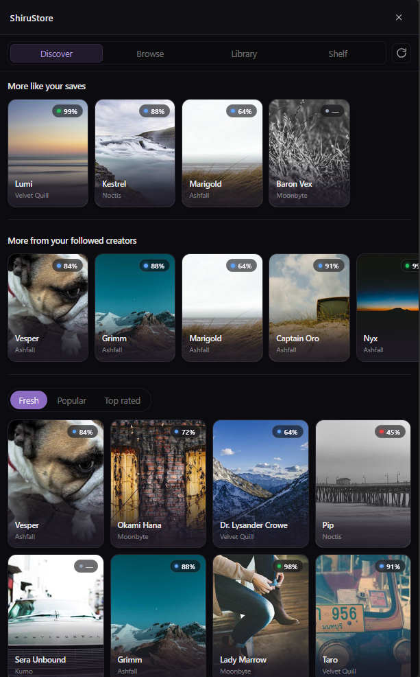
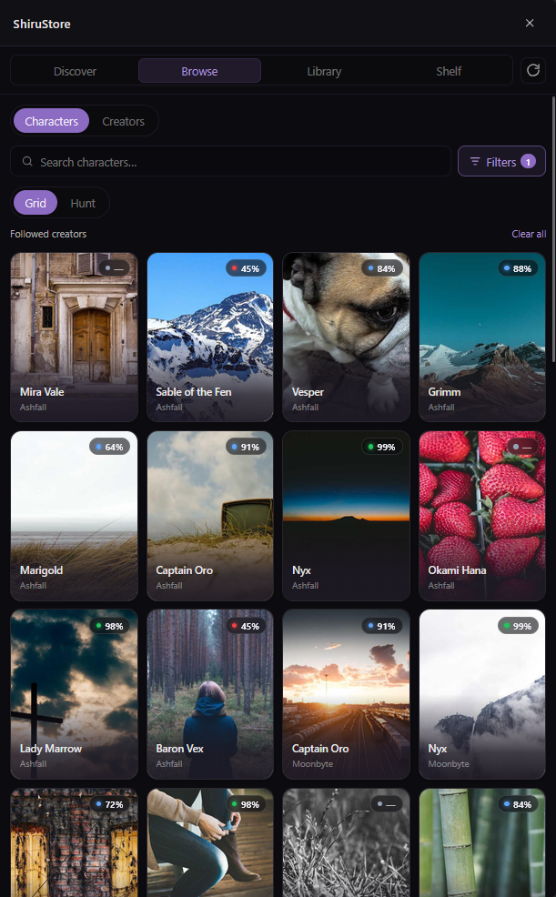
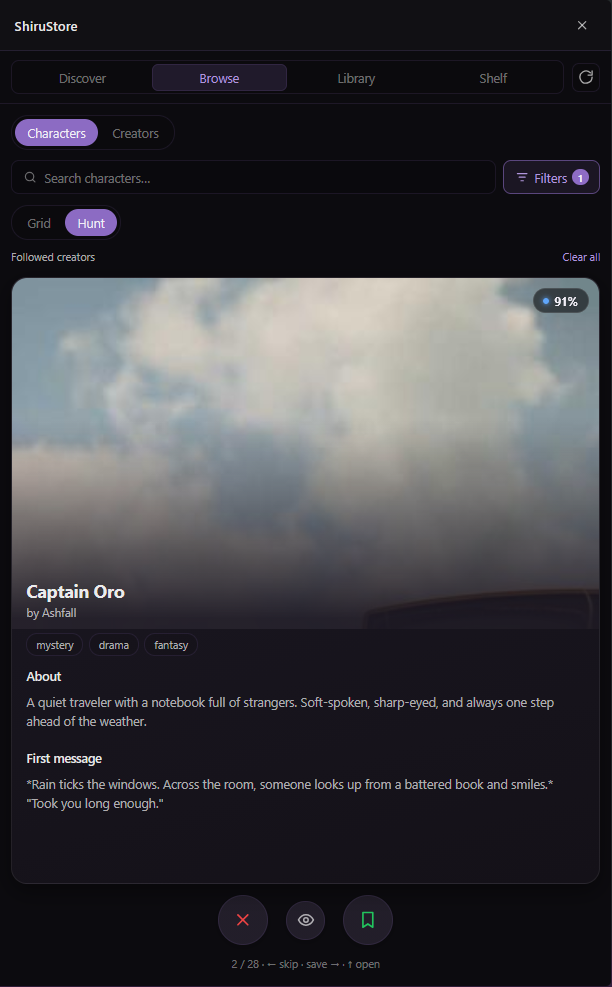
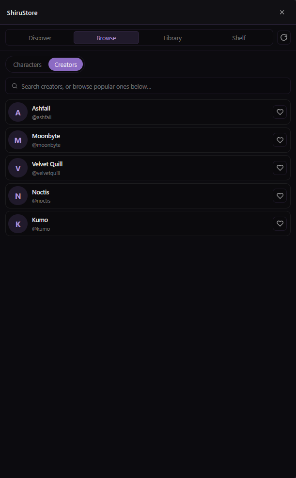
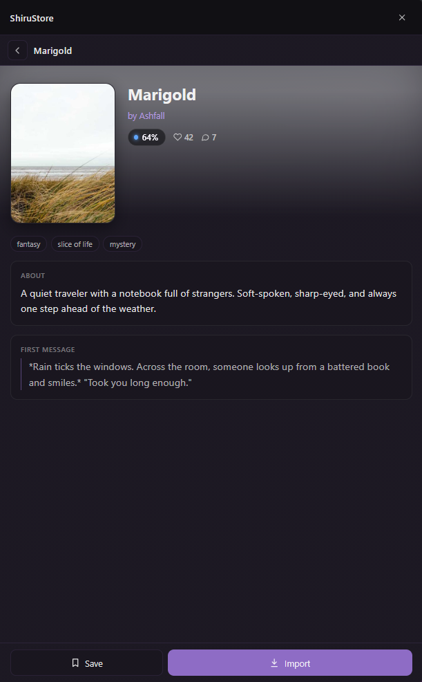
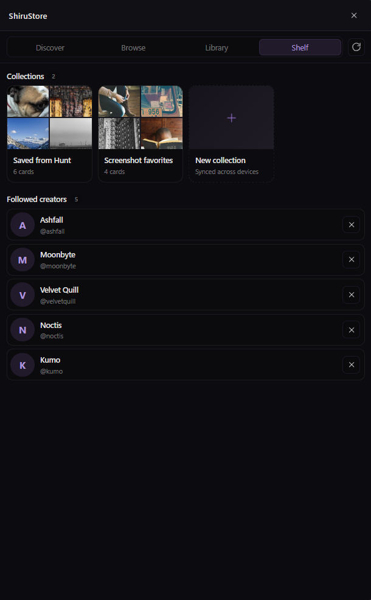
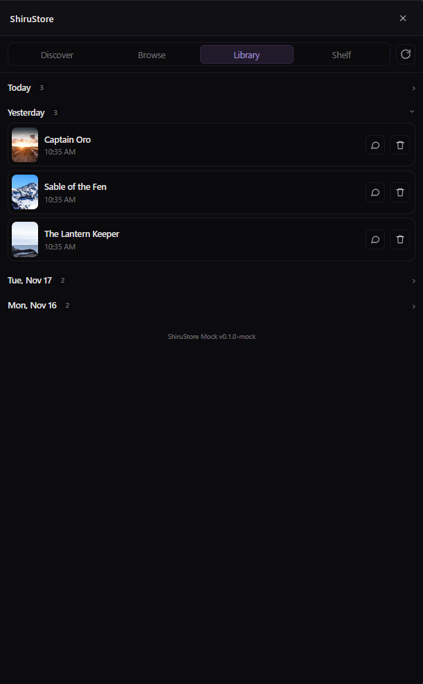

# ShiruStore

<p align="center">
  
</p>

<p align="center">
  
</p>

A [Datacat](https://datacat.run) character store for [Lumiverse](https://github.com/prolix-oc/Lumiverse). Browse, swipe, and import cards without leaving the app. Made mobile first, optimized for desktop as well.

## What it does

### Discover

Open ShiruStore and land on feeds: Fresh, Popular, Top rated. Scroll those to see what is new or what is doing well. If you have saved cards before, a "more like your saves" rail shows up. Follow creators and you get a followed-creators rail too.

<p align="center">
  
</p>

### Browse and Hunt

Need something specific? Switch to Browse. Search the catalog as a grid, or flip to Hunt and swipe through cards. Filters let you cut by finish score, sort, tags (include or exclude), and "only people I follow." Save a filter set as a preset if you reuse it. There is a Creators tab for name or `@handle` lookup when you want to find creators.

<p align="center">
  
  
  
</p>

### Import and Chat

Like a card? Import pulls the card, avatar, and lorebook (when Datacat has one) into your Lumiverse library in one tap. After import you can hit Chat to open or create a conversation with them. Cards you already imported stay out of Discover, Browse, and Hunt so you are not staring at duplicates.

<p align="center">
  
</p>

### Shelf and Library

Shelf is where your collections live, plus the creators you follow (follows stay in ShiruStore, not Datacat account follows). Library is everything you imported here: open again, or remove (drops the ShiruStore entry and deletes the Lumiverse character).

<p align="center">
  
  
</p>

## Install

In Lumiverse, go to **Settings → Extensions → Install from Git** and paste:

```
https://github.com/shirunick/lumi-shirustore
```

It asks for two permissions: `characters` to import cards, and `cors_proxy` to reach Datacat.

Your first import may open a Datacat security check. If your browser blocks it, allow pop-ups for Lumiverse.

## Good to know

- Follows and collections are stored in ShiruStore, not in your Datacat account.
- Excluding tags often works better than including them, because a lot of cards skip obvious tags.
- Pairs well with [LumiLens](https://github.com/shirunick/lumilens). Turn on **Warm on create** in LumiLens and Ari will write pitches and Tinder blurbs in the background as you import cards here.

## License

[MIT](LICENSE).
